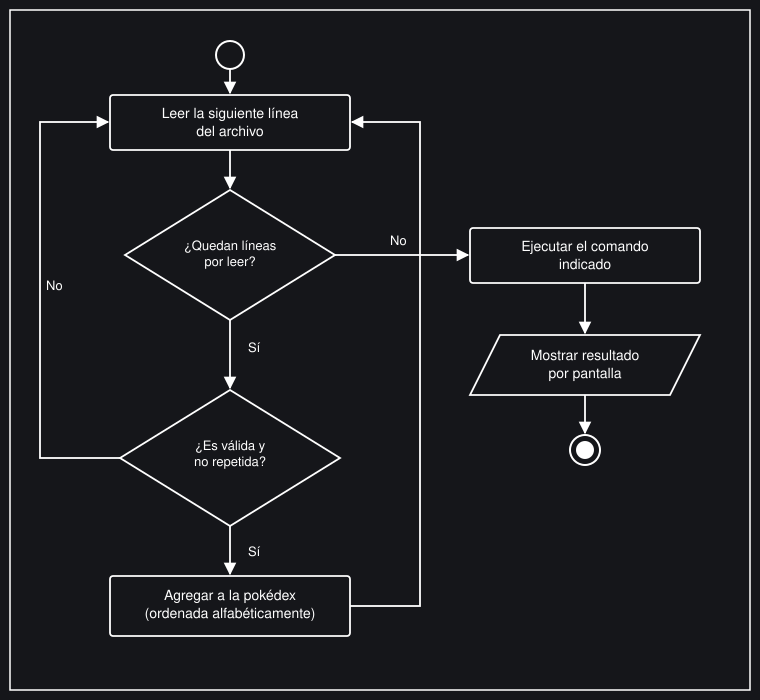
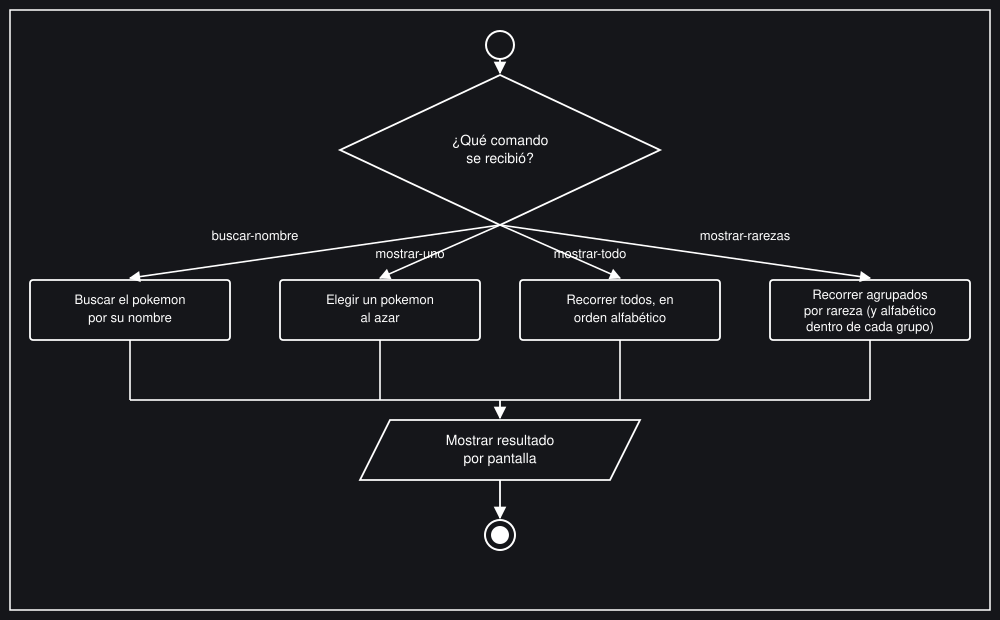
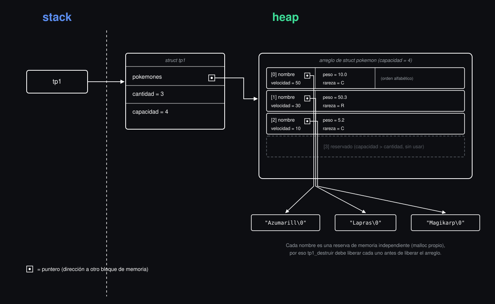

## Información del estudiante

* Matias Armida
* Padrón: 114941
* armidamatias@gmail.com
* matiasnata

---

## Índice
* [1. Instrucciones](#1-Instrucciones)
  * [1.1. Compilar el proyecto](#11-Compilar-el-proyecto)
  * [1.2. Ejecutar las pruebas](#12-Ejecutar-las-pruebas)
  * [1.3. Ejecutar el programa con Valgrind](#13-Ejecutar-el-programa-con-Valgrind)
* [2. Funcionamiento](#2-Funcionamiento)
* [3. Estructura](#3-Estructura)
  * [3.1. Diagrama de memoria](#31-Diagrama-de-memoria)
  * [3.2. Análisis de complejidades](#32-Análisis-de-complejidades)
* [4. Decisiones de diseño y/o complejidades de implementación](#4-Decisiones-de-diseño-yo-complejidades-de-implementación)
* [5. Respuestas a las preguntas teóricas](#5-Respuestas-a-las-preguntas-teóricas)

## 1. Instrucciones

> [!TIP]
> Se recomienda fuertemente crear y usar un Makefile y colocar en esta sección los comandos Make.

### 1.1. Compilar el proyecto
```bash
gcc -std=c99 -Wall -Wconversion -Wtype-limits -pedantic -Werror -O2 -g src/*.c main.c -o tp1
```


### 1.2. Ejecutar las pruebas
```bash
gcc -std=c99 -Wall -Wextra -pedantic -g -Isrc -o pruebas_alumno pruebas/pruebas_alumno.c pruebas/pa2m.c src/tp1.c src/leer_linea.c
./pruebas_alumno
```

### 1.3. Ejecutar el programa con Valgrind
```bash
valgrind --leak-check=full --show-leak-kinds=all --track-origins=yes ./tp1 pokedex.csv mostrar-todo
```

## 2. Funcionamiento

El programa recibe como parámetros la ruta de un archivo de texto con una pokédex. La pokédex consiste en una lista de pokemon, uno por línea y cada uno con su respectivo nombre, velocidad, peso y tipo de rareza. Por último recibe un comando que indica qué operación realizar con los datos (archivo y pokedex), mostrando el resultado por pantalla.

Al iniciar, el programa lee el archivo completo y valida de a una línea por vez. El primer caso es que la línea no cumpla con el formato esperado y se descarte para poder continuar con la lectura de las líneas restantes si es que las hay. El segundo caso es que la línea sea válida, la cual se agregará a un conjunto de pokemon.
En el caso que haya pokemon duplicado, es decir, que el nombre sea igual (sin distinguir mayúsculas y minúsculas) se conservara en el conjunto únicamente la primera aparición del pokemon en el archivo. 
Además, este conjunto se mantiene siempre ordenado alfabéticamente por nombre, sin importar el orden en que los pokemon fueron apareciendo en el archivo.






Según el comando recibido, el programa realiza una de las siguientes acciones:

1) buscar-nombre: busca un pokemon por su nombre (sin distinguir mayúsculas de minúsculas). En el caso de ser encontrado, muestra sus datos, caso contrario informa que no se encuentra en la pokedex.

2) mostrar-uno: elige un pokemon al azar y muestra sus datos.

3) mostrar-todo: muestra todos los pokemon cargados, en orden alfabético.

4) mostrar-rarezas: muestra todos los pokemon agrupados por rareza (primero los comunes, luego los raros y por último los legendarios), respetando el orden alfabético dentro de cada grupo.

Además, el programa permite combinar los datos de dos pokédex en una nueva independiente (sin duplicar los pokemon repetidos entre ambas, priorizando siempre los datos de la primera) y guardar el contenido de una pokédex en un archivo de texto.


## 3. Estructura
Para implementar la estrcutura TDA (tp1_t), definí una estructura con 3 campos.

1) *pokemones: Un puntero a la dirección de un bloque de memoria dinámica (en el Heap) donde se almacenan contiguamente las estructuras pokemon. 

2) cantidad: Es de tipo size_t y representa el tamaño lógico del vector, es decir, el número de pok emonesválidos que ya fueron insertados en la estructura.

3) capacidad: Es de tipo size_t. Representa la memoria real asignada al vector dinámico. Indica el límite de elementos que el bloque actual puede contener sin realizar una redimensión (realloc).

Más allá de que lo pida el enunciado, el vector dinámico nos permite gestionar de forma mas eficiente el uso de la memoria. Al inicio del programa, la estructura puede no tener memoria reservada para el vector (capacidad 0). A medida que se procesa el archivo y se necesita almacenar un nuevo pokemon, se evalúa si se necesita realocar memoria. En el caso de precisar más memoria, se utiliza la función realloc para solicitar al sistema operativo un bloque más grande (duplicando la capacidad actual), copiando de forma automática los datos existentes al nuevo bloque si es necesario reubicarlo en el Heap (en el caso que falle no se pierde la información previa). Esto permite que el programa solo utilice la memoria necesaria.

### 3.1. Diagrama de memoria



### 3.2. Análisis de complejidades

 1) tp1_cantidad: tiene una complejidad de O(1) ya que tiene como parámetro el puntero al TDA, accede y devuelve el valor del campo cantidad mediante el puntero al TDA, realizando una operación de tiempo constante sin importar el tamaño del vector.

2) tp1_buscar_orden: tiene una complejidad de O(1) ya que tiene como parámetro el índice n y el puntero al TDA. Al acceder de forma directa a la posición n del vector dinámico pokemones mediante su índice, no requiere recorrer la estrcutura completa.

3) tp1_buscar_pokemon: tiene una complejidad de O(n) ya que tiene como parámetro el nombre a buscar y el puntero al TDA. Al tener que buscar el nombre recibido por parámetro, en el peor de los casos, recorre linealmente los n elementos del vector usando un bucle while para comparar el nombre buscado con cada pokemon guardado. 

4) tp1_iterar: tiene una complejidad de O(n) ya que tiene como parámetro la función a aplicar y el puntero al TDA. Mientras la función devuelva true, recorre linealmente los n elementos guardados.

5) tp1_escribir_archivo: tiene una complejidad de O(n) ya que tiene como parámetro el nombre del archivo y el puntero al TDA, y se encarga de recorrer los n elementos del vector para imprimirlos uno por uno en el archivo.

6) tp1_destruir: tiene una complejidad de O(n) ya que tiene como parámetro el puntero al TDA y se encarga de iterar n veces para liberar la memoria dinámica de cada string de los nombres antes de destruir la estructura.

7) tp1_leer_archivo:  Tiene una complejidad de O(n^2) ya que tiene como parámetro la ruta del archivo y, al leer el archivo línea por línea, ejecuta un ciclo general a los n pokemones leídos. Por cada línea leída, la función se encarga de invocar otras funciones internas (nombre_valido y agregar_pokemon) que a se encargan de recorrer los elementos ya guardados. Es decir, por cada pokemon nuevo, se debe recorrer el vector para confirmar que el nombre no esté repetido y después realizar un desplazamiento de elementos hacia la derecha para insertarlo en la posición correcta y mantener el orden alfabético. La suma de estos desplazamientos genera la complejidad O(n^2).

8) tp1_combinar: tiene una complejidad de O((n+m)^2) ya que tiene como parámetro dos punteros a TDA distintos (de tamaños n y m respectivamente) y se encarga de iterar sobre cada uno de sus elementos para insertarlos en un nuevo TDA resultante. Al igual que en la lectura de archivos, por cada elemento agregado al TDA resultante, el programa recorre el arreglo resultante completo para verificar que no existan repetidos y hacer los desplazamientos correspondientes para respetar el orden alfabético.

9) leer_linea_ptr: tiene una complejidad de O(n), siendo n la cantidad de caracteres que componen la línea, ya que tiene como parámetros un doble puntero al bloque de memoria, un puntero al tamaño y el puntero al archivo, y, al leer una línea, se encarga de ejecutar un ciclo while que iterará exactamente n veces hasta encontrar el salto de línea (\n) o el fin del archivo (EOF). 

## 4. Decisiones de diseño y/o complejidades de implementación

La mayor complejidad en el TP se me presentó en las funciones encargadas de la lectura e inserción de datos (tp1_leer_archivo y tp1_combinar), ya que requieren parsear cadenas de texto dinámicas, validar duplicados iterando sobre la estructura y, al mismo tiempo, desplazar elementos en memoria para mantener el arreglo ordenado alfabéticamente.

Por este motivo es que decidí modularizar lo más posible para facilitar el trabajo y la lectura de las funciones.

Realicé 4 funciones auxiliares para validar que cada campo del pokemon sea correcto (peso, velocidad, rareza y nombre). Esto me permite primero corroborar que el pokemon tenga sus 4 campos válidos antes de intentar insertarlo.

Además, para separar los datos de cada línea leída, decidí  cambiar las comas por ('\0') directamente sobre el texto original. De esta manera, evito tener que pedir memoria extra para guardar cada palabra por separado. Por último, elegí que la función agregar_pokemon sea la única encargada de agrandar el arreglo (con realloc), lo que me ayuda a no repetir código en otras funciones y a tener un mejor control de la memoria.

## 5. Respuestas a las preguntas teóricas 

### 5.1. Explicar la elección de la estructura para implementar la funcionalida pedida. Justifique el uso de cada uno de los campos de la estructura.
Respondido en su respectiva sección.

### 5.2 ¿Qué es la complejidad computacional y cómo se calcula?
La complejidad computacional es el estudio de la cantidad de recursos, como el tiempo y la memoria, que necesita un algoritmo para resolver un problema en función del tamaño de sus datos de entrada

Para calcularla, se utiliza la notación Big-O (O), que describe el comportamiento en el "peor de los casos" del algoritmo. El cálculo se realiza siguiendo estos pasos:

1) Conteo de operaciones: Se cuenta la cantidad de operaciones que realiza la función (asignaciones, comparaciones, retornos, etc.) en función de n.

2) Identificación del crecimiento: Se analiza cómo se comportan los bucles. Si no hay bucles dependientes de n, el tiempo es constante O(1). Si hay un bucle simple que recorre los datos, es lineal O(n). Si hay un bucle anidado dentro de otro bucle, suele ser cuadrático O(n^2).

3) Reducción de términos: Como en la notación Big-O solo importa la tendencia de crecimiento cuando n tiende a infinito, se descartan todas las constantes y los términos menores. Por ejemplo, si una función realiza 4 + 3n + n^2 operaciones, la complejidad se simplifica quedándonos únicamente con el término de mayor orden, resultando en O(n^2)

### 5.3 Explicar con diagramas cómo quedan dispuestas las estructuras y elementos en memoria.
Respondido en su respectiva sección.

### 5.4 Justificar la complejidad computacional temporal de cada una de las funciones que se piden implementar.
Respondido en su respectiva sección.

### 5.5 Explique qué dificultades tuvo para implementar las funcionalidades pedidas en el main (si tuvo alguna) y explique si alguna de estas dificultades se podría haber evitado modificando la definición del .h
No tuve ninguna dificultad muy grande.